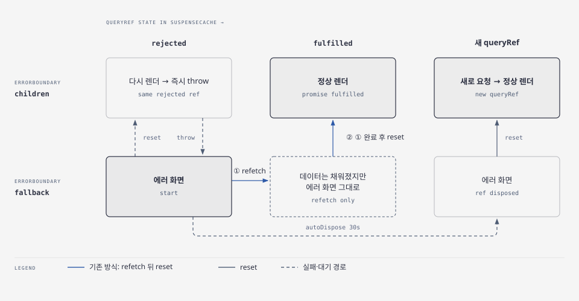
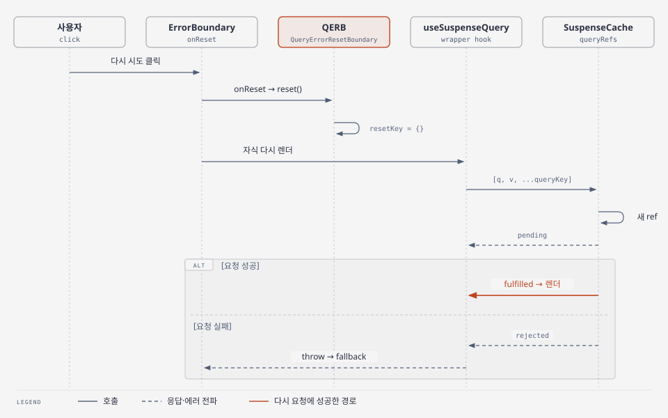
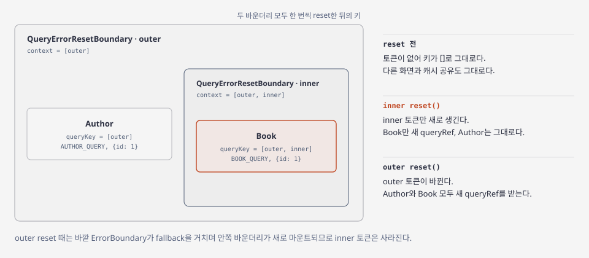

# QueryErrorResetBoundary

---

> **요약**
> - **문제**: `useSuspenseQuery`가 실패한 뒤 `resetErrorBoundary`만 부르면 다시 요청하지 않고 같은 에러를 다시 던집니다. 그래서 지금까지는 바운더리에서 하위 트리의 query와 variables를 그대로 적어 refetch해야 했습니다.
> - **원인**: 실패한 쿼리의 `queryRef`가 `SuspenseCache`에 최대 30초 남아 있고, 같은 키로 다시 렌더하면 그 실패를 그대로 재사용합니다.
> - **해결**: `QueryErrorResetBoundary`가 reset마다 새 토큰을 Context로 내려 주고, 이 패키지의 `useSuspenseQuery`가 그 토큰을 `queryKey`에 붙입니다. 키가 바뀌므로 바운더리 아래 쿼리가 모두 새 `queryRef`로 다시 요청합니다.

## 목차

- [용어](#용어)
- [1. 현행](#1-현행)
- [2. resetErrorBoundary만 요청 시도](#2-reseterrorboundary만-요청-시도)
- [3. refetch가 필요했던 이유](#3-refetch가-필요했던-이유)
  - [3.1 Apollo Client의 두 캐시: InMemoryCache와 SuspenseCache](#31-apollo-client의-두-캐시-inmemorycache와-suspensecache)
  - [3.2 그렇다면 왜 refetch를 했을 때는 에러가 풀릴까?](#32-그렇다면-왜-refetch를-했을-때는-에러가-풀릴까)
  - [3.3 ErrorBoundary 상태와 SuspenseCache의 queryRef 상태 정리](#33-errorboundary-상태와-suspensecache의-queryref-상태-정리)
- [4. 검토한 대안](#4-검토한-대안)
  - [4.1 쿼리 훅의 refetch 재활용](#41-쿼리-훅의-refetch-재활용)
  - [4.2 \[Q,V\]를 공유하기](#42-qv를-공유하기)
  - [4.3 쿼리와 바운더리를 한 곳에 두기](#43-쿼리와-바운더리를-한-곳에-두기)
  - [4.4 resetErrorBoundary만 하고 autoDispose 기다리기](#44-reseterrorboundary만-하고-autodispose-기다리기)
  - [4.5 실패한 operation을 모아 다시 요청하기](#45-실패한-operation을-모아-다시-요청하기)
  - [4.6 QueryErrorResetBoundary](#46-queryerrorresetboundary)
- [5. QueryErrorResetBoundary가 하는 일](#5-queryerrorresetboundary가-하는-일)
  - [5.1 사용법](#51-사용법)
  - [5.2 다시 시도를 누르면 일어나는 일](#52-다시-시도를-누르면-일어나는-일)
  - [5.3 형제 쿼리가 함께 실패할 때](#53-형제-쿼리가-함께-실패할-때)
  - [5.4 중첩된 바운더리](#54-중첩된-바운더리)
  - [5.5 설계에서 정한 것](#55-설계에서-정한-것)
- [6. 감수하는 것](#6-감수하는-것)
- [References](#references)
  - [Apollo Client](#apollo-client)
  - [TanStack Query](#tanstack-query)
  - [Suspensive](#suspensive)

---

## 용어

| 용어 | 뜻 |
| --- | --- |
| [Q, V] | 쿼리 문서(query)와 변수(variables)의 쌍. 같은 [Q, V]면 같은 요청입니다. |
| 렌더와 커밋 | React는 컴포넌트 함수를 실행해(렌더) 결과를 화면에 반영합니다(커밋). 렌더 도중 suspend하거나 throw한 컴포넌트는 커밋되지 않으며, 그 사이 `useState`·`useEffect`도 남지 않습니다. |
| suspend | 컴포넌트가 pending promise를 던져 렌더를 멈추는 것. 가장 가까운 `Suspense`가 fallback을 보여 줍니다. |
| `queryRef` | Apollo가 Suspense 쿼리 하나마다 만드는 내부 객체. 요청의 promise와 결과를 들고 있으며 `SuspenseCache`에 저장됩니다. |
| retain / dispose | 커밋된 컴포넌트가 `queryRef`를 붙잡는 것(retain)과, 아무도 붙잡지 않은 `queryRef`를 정리하는 것(dispose). |
| `autoDisposeTimeoutMs` | retain되지 않은 `queryRef`를 정리하기까지 기다리는 시간. 기본 30초입니다. |
| reset 토큰 | 이 패키지에서 reset할 때마다 새로 만드는 빈 객체 `{}`. `queryKey`에 붙어 `SuspenseCache` 키를 바꿉니다. |

## 1. 현행

`useSuspenseQuery`에서 데이터를 정상적으로 불러오지 못하면 `ErrorBoundary`가 다시 시도할 수 있는 화면을 보여주고, 사용자는 "다시 시도"를 누릅니다. 이때 관습적으로 두 가지 일을 했습니다.
1. refetch: 실패한 데이터를 같은 [Q, V](query, variables)로 다시 요청한다.
2. resetErrorBoundary: 바운더리를 에러 상태에서 풀어 자식을 다시 그리게 한다.

이 방식에서는 다시 요청할 [Q, V]를 하위 트리가 실제로 요청하는 것과 정확히 같게 설정해야 해서 불편합니다. 에러 바운더리를 두는 상위 컴포넌트가 하위 컴포넌트의 구현 사항을 알아야 하며, 하위 컴포넌트가 variables를 바꾸거나 쿼리를 하나 더 쓰기 시작해도 상위 컴포넌트에서는 그 사실을 알 수 없습니다.

불편함을 느끼게 만드는 부분이 어디인지 고민했고 'ErrorBoundary에서 항상 refetch를 해야 할까?'라는 질문을 하게 되었습니다. ErrorBoundary의 책임은 자식이 throw한 에러를 잡아 fallback을 보여 주고 다시 시도할 수 있게 하는 것이며 데이터를 다시 요청하는 일은 데이터를 요청하는 쪽이 할 일이라고 생각했습니다. 그렇다면 '`resetErrorBoundary`만 불러도 자식이 다시 렌더되면서 `useSuspenseQuery`가 다시 호출되고, 데이터도 다시 채워질 수 있지 않을까?'라는 생각과 함께 문제를 해결해보고자 했습니다.

## 2. resetErrorBoundary만 요청 시도

`refetch`를 빼고 `resetErrorBoundary`만 부르도록 바꿔 보았습니다.
```tsx
<ErrorBoundary
  fallbackRender={({ resetErrorBoundary }) => (
    <button onClick={resetErrorBoundary}>다시 시도</button>
  )}
>
  <Suspense fallback={<p>loading</p>}>
    <Book id="1" />
  </Suspense>
</ErrorBoundary>
```

- 기대한 흐름: "에러 화면 → 다시 시도 → `useSuspenseQuery`가 다시 요청 → 로딩 → 데이터 응답"
- 실제 흐름: "에러 화면 → 다시 시도 → `useSuspenseQuery` → 에러 화면"으로 곧장 돌아왔고 네트워크 요청조차 나가지 않았습니다.

## 3. refetch가 필요했던 이유

`refetch`가 필요한 이유가 명확하게 있었다고 판단했고 왜 필요한지 찾아봤습니다.

### 3.1 Apollo Client의 두 캐시: InMemoryCache와 SuspenseCache

이 부분을 이해하려면 Apollo Client의 두 캐시를 먼저 알아야 합니다. Apollo Client에는 `InMemoryCache`와 `SuspenseCache`가 존재하며 아래와 같은 기능을 수행합니다.
| 캐시 | 무엇을 저장하나 | 무엇으로 찾나 |
| --- | --- | --- |
| `InMemoryCache` | 서버 응답 데이터. `__typename`과 id로 정규화해 평평하게 저장한다 | 엔티티 id |
| `SuspenseCache` | Suspense 쿼리 하나하나의 `queryRef` | `[query, variables, ...queryKey]` |

`useSuspenseQuery`는 렌더할 때마다 `SuspenseCache`를 조회합니다. ([SuspenseCache.ts#L28](https://github.com/apollographql/apollo-client/blob/main/src/react/internal/cache/SuspenseCache.ts#L28)) 같은 키의 `queryRef`가 있으면 그것을 그대로 사용하고 없을 때만 새로 만들어 요청을 보냅니다. 같은 키로 다시 렌더되는 한 이전 결과가 계속 재사용되고 이전 결과가 실패였다면 실패도 재사용합니다.

실패한 쿼리를 쓰는 컴포넌트는 다음 순서를 거칩니다.
1. 첫 렌더에서 `useSuspenseQuery`가 새 `queryRef`를 만들고 요청을 보냅니다. promise가 pending이므로 컴포넌트는 suspend하고 가장 가까운 `Suspense`가 로딩 화면을 보여줍니다.
2. 요청이 실패하면 promise가 rejected가 됩니다. React가 컴포넌트를 다시 렌더하고 `useSuspenseQuery`가 rejected promise를 만나 에러를 throw합니다.
3. 에러는 가장 가까운 `ErrorBoundary`로 올라가고 바운더리는 fallback을 그립니다.

이 컴포넌트는 한 번은 suspend, 한 번은 throw를 했습니다. 두 번 모두 렌더 도중에 멈췄으므로 커밋된 적이 없습니다. retain은 커밋 뒤 `useEffect`에서 일어나므로 이 `queryRef`는 한 번도 retain되지 않습니다. ([useSuspenseQuery.ts#762](https://github.com/apollographql/apollo-client/blob/main/src/react/hooks/useSuspenseQuery.ts#L762)) retain되지 않은 `queryRef`는 promise가 끝난 시점부터 `autoDisposeTimeoutMs` 타이머가 돌고 그 시간이 지나야 지워집니다. ([QueryReference.ts#L250](https://github.com/apollographql/apollo-client/blob/main/src/react/internal/cache/QueryReference.ts#L250)) 그 사이에 같은 키로 다시 렌더하면 같은 rejected promise를 받아 같은 에러를 다시 throw합니다.

그렇다면 "Apollo Client에서는 왜 실패한 결과까지 들고 있을까?"에 대한 maintainer의 설명은 다음과 같습니다.

Suspense 중인 컴포넌트는 커밋되지 않으므로 React가 그 컴포넌트 상태를 기억해주지 않습니다. 라이브러리가 대신 상태를 기록해두고 일정 시간(default 30s)이 지나면 정리합니다. (`autoDisposeTimeoutMs`) React는 promise가 끝나면 컴포넌트를 다시 렌더하는데 그때 결과가 유지되어야 합니다. 결과를 너무 빨리 지우면 다시 렌더할 때 새 `queryRef`가 만들어져 요청과 suspend가 끝없이 반복될 수 있습니다. 실제로 이 시간을 0으로 줄이면 그런 반복이 일어나게 됩니다. ([apollo-feature-requests#449](https://github.com/apollographql/apollo-feature-requests/issues/449#issuecomment-2767460366))

### 3.2 그렇다면 왜 refetch를 했을 때는 에러가 풀릴까?

다시 시도할 때 `client.query`로 같은 [Q,V]로 요청하면 성공한 응답이 `InMemoryCache`에 써집니다. 이렇게 `InMemoryCache`에 데이터가 생기면 캐시를 먼저 보는 쿼리의 `queryRef`는 그 데이터를 가져가 fulfilled 상태가 됩니다. 두 가지 방식으로 fulfilled 상태가 될 수 있습니다. (두 경로 모두 쿼리 쪽 `fetchPolicy`가 `cache-first`나 `cache-and-network`일 때만 일어납니다.)
- 실패한 `queryRef`는 에러 뒤에도 `InMemoryCache`의 변경을 계속 지켜보고 있습니다. 이미 rejected된 promise를 fulfilled로 바꿀 수는 없으므로, 캐시에 데이터가 들어오면 promise를 새 fulfilled promise로 교체합니다. ([QueryReference.ts#L550](https://github.com/apollographql/apollo-client/blob/main/src/react/internal/cache/QueryReference.ts#L550))
- 새로 만들어지는 `queryRef`가 처음부터 캐시의 데이터를 읽어 fulfilled 상태로 시작합니다.

그 뒤 resetErrorBoundary로 자식이 다시 렌더되면 `useSuspenseQuery`가 fulfilled promise를 만나 로딩 없이 바로 정상 화면을 그립니다.

refetch는 `SuspenseCache`의 상태를 직접 풀지 않습니다. `InMemoryCache`를 같은 데이터로 채워서 [Q,V]가 같은 `queryRef`가 그 데이터를 가져가게 하는 방식입니다. 그 덕분에 ErrorBoundary의 에러가 풀립니다.

### 3.3 ErrorBoundary 상태와 SuspenseCache의 queryRef 상태 정리



## 4. 검토한 대안

기존 방식의 문제점을 정리해보고 각 대안들을 하나씩 검토해보겠습니다.

기존 문제:
1. **상위 트리가 하위 트리의 구현을 알아야 합니다**: 하위 쿼리에서 어떤 [Q,V]로 요청하는지를 바운더리쪽에서 다시 적어야 합니다.
2. **어긋나도 알아채기 어렵습니다**: 하위 트리의 V가 바뀌었는데 바운더리쪽은 그대로라면 다시 시도를 눌러도 에러가 풀리지 않고(`queryRef`가 정리되는 최대 30초까지), 에러가 나지 않으니 이 문제를 알아차리기 어렵습니다.
3. **바운더리 아래 쿼리가 여러 개라면 모두 적어야 합니다**: 하나라도 빠지면 그 쿼리가 실패했을 때는 복구되지 않습니다.
4. **쿼리의 fetchPolicy에 따라 동작이 달라집니다**: refetch는 `InMemoryCache`를 채우는 방식이라 쿼리가 캐시를 먼저 보는 정책(`cache-first`, `cache-and-network`)일 때만 복구됩니다([3.2](#32-그렇다면-왜-refetch를-했을-때는-에러가-풀릴까)).
5. **refetch와 resetErrorBoundary의 순서가 보장되어야 합니다**: 요청이 끝나기를 기다리지 않고 reset하면 타이밍에 따라 복구가 되지 않을 수 있습니다.

### 4.1 쿼리 훅의 refetch 재활용
"`useSuspenseQuery`가 돌려주는 `refetch` 함수를 fallback에서 부르면 되지 않나?"라는 생각이 자연스럽게 들겁니다. `refetch`를 시도하는 것만 상위 트리에서 알 수 있다면 책임 분리를 할 수 있을테니까요. 안타깝게도 [3.1](#31-apollo-client의-두-캐시-inmemorycache와-suspensecache)에서 본 것처럼 쿼리를 쓰는 컴포넌트는 한 번도 커밋되지 않았기 때문에 훅이 존재하지 않는 상태이고 훅이 돌려줄 `refetch`조차 없습니다. 그래서 지금까지는 다시 요청할 수단을 바운더리 바깥에서 넣어 줘야 했고 그 결과 상위 트리가 하위 트리의 [Q,V]를 알아야 했습니다.

### 4.2 [Q,V]를 공유하기
데이터 요청부와 바운더리가 같은 [Q,V]를 보게 하는 방법입니다.
```tsx
// 예시
const SHARED_QUERY = { query, variables };

// 데이터 요청
const { data } = useSuspenseQuery(SHARED_QUERY.query, { variables: SHARED_QUERY.variables });

// ErrorBoundary: onReset은 요청이 끝나기 전에 reset까지 진행합니다(문제 5)
<ErrorBoundary onReset={() => client.query(SHARED_QUERY)} fallbackRender={...}>
  {...}
</ErrorBoundary>
```

이 방법은 데이터 요청부만 변경하거나 바운더리만 고쳐서 둘이 어긋나는 일은 없앨 수 있습니다. 다만 상위 트리가 하위 트리의 구현을 알아야 한다는 점은 달라지지 않습니다. 또한 동적인 variables를 사용해야 하는 경우에는 여전히 어긋날 수 있다는 위험이 있고 다중 쿼리 바운더리, fetchPolicy, 순서의 문제도 해결되지 않습니다.

### 4.3 쿼리와 바운더리를 한 곳에 두기
Suspensive의 [SuspenseQuery](https://suspensive.org/en/docs/react-query/SuspenseQuery)처럼 쿼리를 컴포넌트로 감싸 데이터 요청하는 코드와 에러 바운더리를 같은 자리에 두고 [4.2](#42-qv를-공유하기)를 사용하는 방법입니다.

```tsx
const SHARED_QUERY = { query, variables };

<ErrorBoundary
  fallbackRender={({ resetErrorBoundary }) => (
    <RetryView
      onClick={async () => {
        try {
          await client.query(SHARED_QUERY); // 요청이 끝난 뒤에
          resetErrorBoundary(); // reset
        } catch {
          // 다시 실패하면 에러 화면에 머문다
        }
      }}
    />
  )}
>
  <SuspenseQuery query={SHARED_QUERY.query} options={{ variables: SHARED_QUERY.variables }}>
    {({ data }) => <Book data={data} />}
  </SuspenseQuery>
</ErrorBoundary>
```

상위 트리가 하위 트리를 알아야 한다는 문제는 남지만 쿼리와 바운더리가 한눈에 보이는 곳에 함께 있어 무엇을 다시 요청하는지 코드에서 바로 보이니 기존보다 직관적입니다.

하지만 이 이점을 얻으려면 모든 SuspenseQuery를 이 컴포넌트 형태로 다시 써야 하며, 이미 훅으로 작성된 쿼리, 한 컴포넌트에서 여러 쿼리를 함께 쓰는 경우, 바운더리를 화면 단위로 크게 두는 경우까지 모두 이 구조로 바꾸라고 강요할 수 없습니다.

### 4.4 resetErrorBoundary만 하고 autoDispose 기다리기
처음 생각했던 대안으로 `resetErrorBoundary`만 시도하고 `queryRef`가 dispose되기만을 기다리는 방법입니다. 우리가 가진 5가지 문제를 해결할 수 있게 되지만 유저가 30초 안에 누르면 아무 일도 일어나지 않는 다른 문제를 겪게 됩니다. 화면이 1초만 느려도 느리다고 느끼는 사용자에게 30초는 너무 길며, 사용자는 다시 시도를 누르면 에러 화면이 바로 풀리기를 기대하기 때문에 기각했습니다.

추가로, `autoDisposeTimeoutMs`를 줄이는 방법도 고려했으나 이는 실패한 쿼리 뿐만 아니라 클라이언트 Suspense 쿼리의 정리 시점을 정하는 것이며, [apollo-feature-requests#449](https://github.com/apollographql/apollo-feature-requests/issues/449#issuecomment-2767460366)에서 설명했듯이 쿼리와 suspend가 순환하는 문제가 발생할 수 있으므로 기각했습니다.

### 4.5 실패한 operation을 모아 다시 요청하기
[apollo-feature-requests#449](https://github.com/apollographql/apollo-feature-requests/issues/449#issuecomment-2767460366)에서 올라온 아이디어에서 출발한 방식입니다. 우리가 `InMemoryCache`를 채우는 방식은 그대로 유지하되 바운더리에서 operation을 지정하기보다는 실패한 operation을 Apollo Link에서 수집합니다. 바운더리에서는 단순히 실패한 operation들을 다시 요청합니다.

```tsx
const operationByError = new WeakMap<object, Operation>();

const collectFailedOperationLink = onError(({ operation, networkError }) => {
  if (networkError) operationByError.set(networkError, operation);
});

// 다시 시도: 바운더리가 받은 에러에서 operation을 찾아 다시 요청한 뒤 reset
const retry = async (error: ApolloError) => {
  const op = error.networkError ? operationByError.get(error.networkError) : undefined;
  if (op) await client.query({ query: op.query, variables: op.variables });
  resetErrorBoundary();
};
```

각 트리는 자기가 받은 에러만 보므로 다른 섹션의 operation을 건들지 않은 채 `InMemoryCache`를 채웁니다. 다만 아래와 같은 문제가 남습니다.
- 바운더리는 에러를 하나씩만 받을 수 있어 같은 바운더리 아래 형제 쿼리가 여러 개 실패해도 하나씩 다시 시도를 해야 합니다. 즉, 실패한 쿼리 수만큼 다시 시도를 눌러야 합니다.
- `InMemoryCache`를 채우는 우회로이기 때문에 fetchPolicy에 따라서 해결이 안 될 수도 있습니다.
- `networkError`만 기록하기 때문에 다른 에러로 발생한 경우는 찾지 못합니다.


### 4.6 QueryErrorResetBoundary
다른 데이터 페칭 라이브러리는 이 문제를 구조적으로 어떻게 푸는지 찾아보다가 [TanStack Query의 `QueryErrorResetBoundary`](https://tanstack.com/query/latest/docs/framework/react/reference/QueryErrorResetBoundary)에서 아이디어를 얻었습니다.

TanStack Query도 에러 바운더리에 잡힌 쿼리가 다시 마운트될 때 바로 다시 요청하지 않도록 막아둡니다. 하지만 `QueryErrorResetBoundary`로 감싸면 바운더리가 reset되었다는 신호를 Context로 내려보내고 쿼리 훅은 그 신호를 보고 "이번에는 다시 요청해도 된다"고 판단합니다. ([`errorBoundaryUtils.ts`](https://github.com/TanStack/query/blob/main/packages/react-query/src/errorBoundaryUtils.ts)) 즉, dispose 시간을 조절하는 대신 reset이라는 특정 상황에서만 재시도하도록 유도해 문제를 풉니다.

다만 이 구조를 Apollo에 똑같이 옮길 수는 없었습니다. TanStack의 쿼리 훅은 라이브러리 안에서 이 Context를 읽지만, Apollo의 `useSuspenseQuery`는 그런 Context를 읽지 않습니다. 그래서 Apollo가 이미 공개해 둔 옵션인 [queryKey](https://www.apollographql.com/docs/react/data/suspense#distinguishing-between-queries-with-querykey)를 써서 문제를 해결했습니다. Context를 읽어 `queryKey`에 붙이는 일은 Apollo의 `useSuspenseQuery`를 감싼 이 패키지의 `useSuspenseQuery`가 맡습니다.

`queryKey`는 원래 같은 query와 variables를 쓰는 두 컴포넌트가 서로 다른 `queryRef`를 갖게 할 때 쓰는 옵션입니다. `SuspenseCache`의 키가 `[query, variables, ...queryKey]`이므로, `queryKey`가 다르면 같은 쿼리라도 다른 항목으로 취급됩니다. 이것을 reset에 써서 reset할 때 `queryKey`를 바꾸면 `SuspenseCache`는 이전의 rejected `queryRef`를 찾지 못하고 새 `queryRef`를 초기 상태부터 만듭니다. refetch도 dispose도 없이 쿼리가 스스로 다시 요청하게 됩니다.

`queryKey`를 원래 용도와 다르게 쓰는 것이 또 다른 우회(hack)가 아니냐는 질문이 나올 수 있습니다. `queryKey`는 문서화된 공개 옵션이고, 이 방식은 Apollo 내부 동작이나 전역 설정을 건드리지 않습니다. 특정 HACK에 기대지 않는다는 점에 더해 다음 장점도 있습니다.

- **ErrorBoundary는 자기 책임만 가집니다.** 에러를 잡고 reset을 제공할 뿐입니다.
- **`SuspenseCache` 수준에서 해결합니다.** `InMemoryCache`를 채우는 우회로가 아니라, 문제의 원인인 `SuspenseCache`의 `queryRef`를 새로 만들게 합니다.

여러 테스트로 이 동작을 확인한 뒤 [apollo-feature-requests#449에 아이디어를 공유했고](https://github.com/apollographql/apollo-feature-requests/issues/449#issuecomment-6892997411), 메인테이너도 [충분히 가능한 방법이라고 답했습니다](https://github.com/apollographql/apollo-feature-requests/issues/449#issuecomment-6957089411).

## 5. QueryErrorResetBoundary가 하는 일

### 5.1 사용법

`QueryErrorResetBoundary`로 `ErrorBoundary`를 감싸고, 받은 `reset`을 `ErrorBoundary`의 `onReset`에 넘깁니다. 쿼리는 `@apollo/client`가 아니라 이 패키지의 `useSuspenseQuery`로 씁니다. 시그니처는 Apollo의 것과 같습니다.

```tsx
import {
  ErrorBoundary,
  QueryErrorResetBoundary,
  useSuspenseQuery,
} from "@labs/apollo-client/query-error-reset-boundary";

const Page = () => (
  <QueryErrorResetBoundary>
    {({ reset }) => (
      <ErrorBoundary
        onReset={reset}
        fallbackRender={({ resetErrorBoundary }) => (
          <button onClick={resetErrorBoundary}>다시 시도</button>
        )}
      >
        <Suspense fallback={<p>loading</p>}>
          <Book id="1" />
        </Suspense>
      </ErrorBoundary>
    )}
  </QueryErrorResetBoundary>
);

const Book = ({ id }: { id: string }) => {
  // 바운더리는 이 쿼리의 query와 variables를 몰라도 됩니다
  const { data } = useSuspenseQuery(BOOK_QUERY, { variables: { id } });
  return <p>{data.book.title}</p>;
};
```

바운더리 쪽에는 다시 요청할 [Q, V]를 적지 않습니다. `Book`이 variables를 바꾸거나 쿼리를 더 써도 바운더리 코드는 그대로입니다.

### 5.2 다시 시도를 누르면 일어나는 일



1. 사용자가 다시 시도를 누르면 `ErrorBoundary`가 `QueryErrorResetBoundary`의 `reset()`을 부릅니다.
2. `QueryErrorResetBoundary`는 새 토큰 `{}`을 state에 넣습니다. Context 값은 `[...부모 토큰, 새 토큰]`이 됩니다.
3. `ErrorBoundary`가 에러 상태를 풀고 자식을 다시 렌더합니다. 1~3은 같은 업데이트 안에서 일어나므로, 자식은 처음부터 새 Context 값으로 렌더됩니다.
4. 다시 렌더된 `useSuspenseQuery`(이 패키지의 래퍼)는 Context에서 토큰을 읽어 사용자가 넘긴 `queryKey` 앞에 붙입니다. Apollo에 넘어가는 `queryKey`는 `[...토큰, ...사용자 queryKey]`가 되고, `SuspenseCache`의 키는 `[query, variables, ...queryKey]`로 바뀝니다.
5. 토큰은 새로 만든 객체이므로 `SuspenseCache`에 같은 키가 없습니다. 새 `queryRef`를 만들고 `fetchPolicy`에 따라 요청을 보냅니다. 컴포넌트는 suspend하고 `Suspense`가 로딩 화면을 보여 줍니다.
6. 요청이 성공하면 데이터를 그립니다. 다시 실패하면 에러가 `ErrorBoundary`로 올라가 다시 시도 버튼이 보입니다. 저절로 반복하지 않으므로 무한 재시도는 없습니다.

이전의 rejected `queryRef`는 이제 아무도 조회하지 않습니다. 커밋된 적이 없어 retain도 되지 않았으므로 `autoDisposeTimeoutMs`가 지나면 Apollo가 원래대로 정리합니다.

### 5.3 형제 쿼리가 함께 실패할 때

한 바운더리 아래에 각자 `Suspense`로 감싼 형제 쿼리 A, B, C가 있다고 해 봅시다. 시간 순서로 보면 이렇습니다.

1. 첫 렌더에서 A, B, C가 각자 `queryRef`를 만들어 요청을 보내고, 각자의 `Suspense` 안에서 suspend합니다.
2. 요청이 하나씩 실패합니다. React는 먼저 끝난 쿼리부터 다시 렌더하고, 그 쿼리가 에러를 throw하면 가장 가까운 에러 바운더리까지 되감습니다. 그 렌더에서 남은 형제는 그리지 않습니다.
3. 그래서 바운더리는 에러를 하나만 받습니다. 처음에는 **먼저 실패한** 쿼리의 에러를 받습니다. 나머지 쿼리의 `queryRef`도 rejected지만, 그려지지 않았으니 바운더리까지 올라온 에러가 없습니다.
4. reset 뒤에 자식을 다시 그리면 이미 rejected인 형제들이 함께 렌더되고, 이번에는 **트리에서 앞선** 쿼리가 먼저 throw합니다.

실험에서 A가 60ms, B가 10ms에 실패하도록 하자 바운더리는 B의 에러를 먼저 받았고, 둘 다 20ms에 실패하도록 하자 트리에서 앞선 A의 에러를 받았습니다.

바운더리가 에러를 하나만 받으므로 "바운더리가 받은 에러의 쿼리만 다시 요청하는" 방식은 형제가 여러 개일 때 약합니다. A, B, C가 모두 실패했고 바운더리가 A의 에러를 먼저 받았다고 할 때 다시 시도를 누르면 이렇게 됩니다.

| 다시 시도 | 받은 에러의 쿼리만 다시 요청([4.5](#45-실패한-operation을-모아-다시-요청하기)) | 다시 요청할 쿼리로 A만 적어 둔 경우([1](#1-현행)의 기존 방식) | QueryErrorResetBoundary |
| --- | --- | --- | --- |
| 1번째 | A 복구, B의 에러가 올라옴 | A 복구, B의 에러가 올라옴 | 바운더리 아래 키가 모두 바뀌어 A, B, C가 함께 다시 요청 |
| 2번째 | B 복구, C의 에러가 올라옴 | A를 또 요청, B는 그대로 | (이미 복구) |
| 3번째 | C 복구 | B의 `queryRef`가 지워질 때(30초)까지 끝나지 않음 | |

`QueryErrorResetBoundary`는 어떤 쿼리가 실패했는지 알 필요가 없습니다. 바운더리 아래 키를 통째로 바꾸고 각 쿼리가 새 `queryRef`로 다시 요청하므로 한 번에 복구됩니다.

### 5.4 중첩된 바운더리

토큰은 부모 토큰 뒤에 이어 붙으므로 바깥 reset은 안쪽 쿼리까지 닿고 안쪽 reset은 바깥 쿼리에 영향을 주지 않습니다. 그림은 두 바운더리가 모두 한 번씩 reset된 뒤의 키를 보여 줍니다.



바깥 바운더리가 에러를 잡으면 바깥 `ErrorBoundary`가 fallback을 그리면서 안쪽 `QueryErrorResetBoundary`도 언마운트됩니다. 그래서 바깥 reset 뒤에 안쪽 바운더리는 토큰 없이 새로 마운트되고, 안쪽 쿼리의 키는 바깥 토큰만 담게 됩니다.

### 5.5 설계에서 정한 것

아래는 PoC와 실험을 거치며 정한 구현 세부 사항입니다.

- **초기 토큰은 `null`입니다.** reset 전에는 부모 키를 그대로 내려보내므로, 쿼리 키가 이 컴포넌트를 쓰기 전과 같습니다. 같은 쿼리를 쓰는 다른 화면과 `SuspenseCache`를 공유하던 동작도 유지됩니다.
- **토큰은 렌더 중에 만들지 않습니다.** 예를 들어 쿼리 훅 안에서 `useState(() => ({}))`로 키를 만들면 그 컴포넌트가 처음 렌더에서 suspend할 때 state가 남지 않습니다([용어](#용어)의 "렌더와 커밋"). 그러면 다시 렌더할 때마다 새 키가 생겨 새 요청과 suspend가 끝없이 반복됩니다([Apollo 포럼 #7780](https://community.apollographql.com/t/can-i-give-every-suspense-query-a-random-unique-querykey/7780)). 그래서 토큰은 suspend하지 않는 바깥 컴포넌트(`QueryErrorResetBoundary`)가 갖고, `reset()`이 불릴 때만 만듭니다.
- **토큰은 숫자가 아니라 매번 새 객체입니다.** 숫자로 세면 안쪽 바운더리의 첫 reset과 바깥 바운더리의 첫 reset이 둘 다 `[1]` 같은 같은 키를 만들어, 서로 다른 reset이 같은 `queryRef`를 가리킬 수 있습니다. 새 객체는 참조로 비교되므로(`{} !== {}`) 같은 값이 다시 나오지 않습니다.
- **토큰은 지우지 않습니다.** TanStack은 boolean 신호를 켰다가 먼저 커밋된 쿼리가 끄는 방식이라, 같은 바운더리 아래에서 늦게 렌더되는 형제가 reset을 보지 못한다는 보고가 있습니다([TanStack/query#2712](https://github.com/TanStack/query/issues/2712)). 여기서는 토큰이 키의 일부로 남아 있으니 형제마다 같은 토큰을 봅니다.

## 6. 감수하는 것

이 방식에는 다음 부작용이 따릅니다.

1. **같은 `[query, variables]`를 공유하던 쿼리가 각자 다시 요청할 수 있습니다.** 한 화면에서 같은 쿼리를 두 곳에서 쓰면 원래는 `queryRef` 하나를 공유합니다. `queryKey`를 바꾸는 방식이라 reset으로 한쪽의 `queryKey`만 바뀌면 둘의 키가 갈라져 각자 다시 쿼리를 보냅니다.
2. **성공했던 쿼리도 정책에 따라 다시 요청합니다.**
   - **이 방식과 무관하게 원래 일어나는 일**: 같은 `ErrorBoundary` 아래에서 성공했던 쿼리는 바운더리가 fallback을 그릴 때 언마운트되고, 그 `queryRef`는 곧바로 정리됩니다. 그래서 reset 뒤에는 새 `queryRef`로 다시 렌더되고, `cache-first`라면 캐시에 남은 데이터를 쓰지만 다른 정책은 다시 요청합니다.
   - **이 방식 때문에 추가로 다시 요청되는 경우 (1)**: `QueryErrorResetBoundary` 범위 안에 있으면서 reset 시점에 아직 화면에 남아 있던 쿼리입니다. 즉 `ErrorBoundary` 바깥이지만 `QueryErrorResetBoundary` 안쪽에 있는 쿼리입니다.
   - **이 방식 때문에 추가로 다시 요청되는 경우 (2)**: 같은 `Suspense` 아래에서 형제는 실패하고 자기는 성공한 쿼리입니다. 형제의 throw 때문에 커밋되지 못해 fulfilled `queryRef`가 retain 없이 남아 있습니다. reset만 하면 이것을 다시 쓰지만, 키가 바뀌면 `cache-first`가 아닌 정책에서는 다시 요청합니다.
3. **어떤 쿼리가 다시 요청됐는지 명시적으로 알기 어렵습니다.** 이전에는 다시 요청하는 코드를 보면 됐지만, 이제는 코드에서 보이지 않습니다. 디버깅이 이전보다 어려워질 수 있습니다.
4. **재시도 중에 로딩 화면을 거칩니다.** 이전에는 refetch가 진행되는 동안 에러 화면에 머물렀고, 실패하면 에러 화면 그대로였습니다. 이제는 새 `queryRef`가 suspend하므로 Suspense fallback이 보였다가, 다시 실패하면 에러 화면으로 돌아갑니다.
5. **버려진 `queryRef`가 잠시 남습니다.** reset으로 버려진 rejected `queryRef`는 `autoDisposeTimeoutMs` 동안 캐시 구독을 유지한 뒤 정리됩니다. 시간 상한이 있어 무한히 쌓이지는 않지만, 그 사이 여러 번 reset하면 그만큼 남습니다.

그래도 감당할 만한 범위라고 판단했습니다. 사람이나 AI가 다시 요청할 query나 variables를 잘못 적는 실수를 하면 다시 시도를 눌러도 에러가 풀리지 않는데, 이런 일이 생기면 사용자 경험에 주는 타격이 큽니다. 누르면 풀리고 있다는 것을 보여주고, 안전하게 정상적인 화면을 보여주는 것이 중요한 것이지 최적화할 영역이 아니라고 생각했습니다.

## References

### Apollo Client

- [Suspense 문서: `queryKey`로 쿼리 구분하기](https://www.apollographql.com/docs/react/data/suspense#distinguishing-between-queries-with-querykey)
- [`SuspenseCache.ts`](https://github.com/apollographql/apollo-client/blob/main/src/react/internal/cache/SuspenseCache.ts#L28)
- [apollo-client#10700: `useSuspenseQuery`에 `queryKey` 옵션 추가](https://github.com/apollographql/apollo-client/pull/10700)
- [apollo-client#11660: 새 컴포넌트에서도 실패한 쿼리를 다시 시도하지 않음](https://github.com/apollographql/apollo-client/issues/11660)
- [apollo-client#12181: suspenseQuery에 에러가 캐시됨](https://github.com/apollographql/apollo-client/issues/12181)
- [apollo-feature-requests#449](https://github.com/apollographql/apollo-feature-requests/issues/449)
  - [실패한 operation을 링크로 다시 요청하자는 제안](https://github.com/apollographql/apollo-feature-requests/issues/449#issuecomment-2752567059)
  - [`SuspenseCache`가 필요한 이유에 대한 메인테이너 설명](https://github.com/apollographql/apollo-feature-requests/issues/449#issuecomment-2767460366)
  - [`queryKey`로 리셋하는 아이디어 공유](https://github.com/apollographql/apollo-feature-requests/issues/449#issuecomment-6892997411)
  - [메인테이너 답변](https://github.com/apollographql/apollo-feature-requests/issues/449#issuecomment-6957089411)
- [Apollo 포럼 #7780: 모든 Suspense 쿼리에 무작위 queryKey를 줘도 되는가](https://community.apollographql.com/t/can-i-give-every-suspense-query-a-random-unique-querykey/7780)

### TanStack Query

- [`QueryErrorResetBoundary` 레퍼런스](https://tanstack.com/query/latest/docs/framework/react/reference/QueryErrorResetBoundary)
- [`QueryErrorResetBoundary.tsx`](https://github.com/TanStack/query/blob/main/packages/react-query/src/QueryErrorResetBoundary.tsx)
- [`errorBoundaryUtils.ts`](https://github.com/TanStack/query/blob/main/packages/react-query/src/errorBoundaryUtils.ts)
- [TanStack/query#980: reset error boundary 컴포넌트 추가](https://github.com/TanStack/query/pull/980)
- [TanStack/query#2712: ErrorBoundary에 잡힌 쿼리가 마운트 때 재시도되지 않음](https://github.com/TanStack/query/issues/2712)

### Suspensive

- [`SuspenseQuery`](https://suspensive.org/en/docs/react-query/SuspenseQuery)
- [`ErrorBoundaryGroup`](https://suspensive.org/docs/react/ErrorBoundary)
